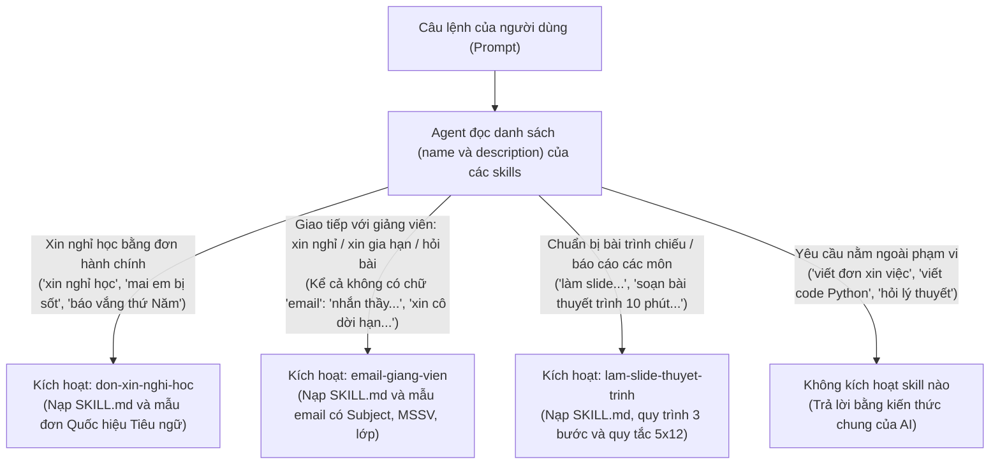

# Giải thích chi tiết về Agent Skills: Bản chất, mục đích và cơ chế hoạt động

> **Bài học:** Tìm hiểu AI Agent - Trường Đại học Giao thông Vận tải TP.HCM (UTH)
>
> **Sinh viên thực hiện:** Nguyễn Tuấn Khang (`077206003397`)

---

## 1. Agent Skills là gì?

**Agent Skills** là những gói tri thức và quy trình làm việc dạng mô-đun giúp mở rộng năng lực của AI Agent cho các tác vụ chuyên biệt.

Thay vì chỉ là một câu lệnh (prompt) rời rạc, **mỗi skill là một thư mục độc lập** có cấu trúc tiêu chuẩn:

```text
my-skill/
├── SKILL.md          # [Bắt buộc] File hướng dẫn chính có YAML frontmatter (name, description)
├── scripts/          # [Tùy chọn] Code/script để Agent tự động chạy khi cần
├── references/       # [Tùy chọn] Tài liệu quy định, hướng dẫn dài, sổ tay tra cứu
├── assets/           # [Tùy chọn] Mẫu đơn, biểu mẫu, template cố định
└── examples/         # [Tùy chọn] Ví dụ mẫu và kết quả kiểm thử đầu ra
```

Trong file `SKILL.md`, cấu trúc luôn gồm 2 phần tách biệt:
1. **YAML frontmatter (phần định danh ở đầu file):**
   * `name`: Tên định danh duy nhất của skill (viết thường, nối bằng dấu gạch ngang, ví dụ: `don-xin-nghi-hoc`, `email-giang-vien`, `lam-slide-thuyet-trinh`).
   * `description`: Mô tả ngắn gọn **skill này làm gì**, **khi nào Agent nên kích hoạt nó**, và **khi nào không nên kích hoạt nó**. Đây là trường quan trọng nhất vì Agent dựa vào `description` để quyết định có gọi skill hay không.
2. **Markdown body (phần quy trình chi tiết):** Hướng dẫn từng bước, biểu mẫu, quy tắc kiểm tra chất lượng mà Agent phải tuân theo khi skill được kích hoạt.

---

## 2. Agent Skills được tạo ra để làm gì?

Agent Skills được tạo ra để biến một AI tổng quát (chỉ biết trả lời chung chung) thành một **trợ lý chuyên gia hiểu rõ quy trình, biểu mẫu và ngữ cảnh riêng của bạn hoặc tổ chức của bạn**:
1. **Chuẩn hóa quy trình làm việc:** Đóng gói các bước làm việc chuẩn (ví dụ: *Hỏi đề tài và thời lượng -> Lập dàn ý -> Viết từng slide theo quy tắc 5x12*) thành một kịch bản cố định để lần nào AI thực hiện cũng đạt chất lượng đồng nhất.
2. **Tái sử dụng ở mọi nơi:** Khi cài đặt ở cấp độ **toàn cục (Global)**, bạn chỉ cần viết skill 1 lần và sử dụng nó trong tất cả các dự án, môn học khác nhau trên máy tính.
3. **Chia sẻ tri thức dễ dàng:** Vì mỗi skill chỉ là một thư mục chứa văn bản và script, bạn có thể đẩy lên **GitHub** để bạn bè cùng lớp hoặc đồng nghiệp tải về cài đặt và dùng ngay theo cùng một quy chuẩn.

---

## 3. Mục đích của Agent Skills là để giải quyết những vấn đề gì?

Trước khi có Agent Skills, người dùng AI thường gặp **4 vấn đề lớn**. Agent Skills sinh ra để giải quyết triệt để cả 4 vấn đề này:

| Vấn đề khi chưa có Agent Skills | Cách Agent Skills giải quyết triệt để |
| :--- | :--- |
| **1. Lặp lại prompt và thiếu nhất quán**<br>Mỗi lần mở cuộc trò chuyện mới lại phải gõ lại họ tên, MSSV, trường, mẫu đơn, quy tắc trình bày. Nếu quên dặn một ý, AI sẽ trả lời thiếu hoặc sai định dạng. | **Đóng gói sẵn biểu mẫu và quy chuẩn vào `SKILL.md` và `assets/`:**<br>Chỉ cần nói ngắn gọn *"mai em bị sốt"* hoặc *"nhắn thầy xin nộp trễ đồ án 2 ngày"*, Agent tự động nạp đúng mẫu chuẩn kèm đầy đủ thông tin định danh. |
| **2. Quá tải bộ nhớ ngữ cảnh**<br>Nếu nhồi tất cả quy tắc (viết code, viết đơn, viết email, làm slide, quy định trường...) vào một file `CLAUDE.md` hoặc `GEMINI.md` duy nhất, AI phải đọc hàng chục ngàn từ ở mọi câu hỏi -> Tốn token, phản hồi chậm và bị loãng sự chú ý. | **Cơ chế tiết lộ lũy tiến (Progressive Disclosure):**<br>Mặc định Agent **chỉ nạp `name` và `description`** của các skill (chỉ tốn vài chục token). Khi câu hỏi của người dùng thực sự khớp với skill nào, Agent mới mở file `SKILL.md` (và `references/`) của đúng skill đó ra đọc. |
| **3. Xung đột quy tắc giữa các tác vụ**<br>Khi để chung nhiều hướng dẫn trong một prompt lớn, AI dễ trộn lẫn văn phong hành chính của "Đơn xin nghỉ học" vào "Email hỏi bài" hoặc áp dụng nhầm khi người dùng hỏi "Đơn xin việc". | **Kiến trúc mô-đun độc lập và ranh giới `description`:**<br>Mỗi skill nằm ở một thư mục riêng biệt. Trong `description` của từng skill quy định rõ điều kiện kích hoạt và điều kiện loại trừ (*Không dùng khi...*), giúp các skill không bao giờ giẫm chân lên nhau. |
| **4. AI không biết cách tự chạy công cụ hoặc tra cứu tài liệu nội bộ**<br>Mô hình ngôn ngữ lớn không tự biết quy định riêng của trường hay script tự động hóa trên máy của bạn. | **Kết hợp hướng dẫn, tài liệu (`references/`) và mã thực thi (`scripts/`):**<br>Skill dẫn đường cho Agent biết chính xác phải đọc file tham khảo nào hoặc chạy script nào ở từng bước. |

---

## 4. Sơ đồ cơ chế hoạt động và chống xung đột của bộ 3 skills


